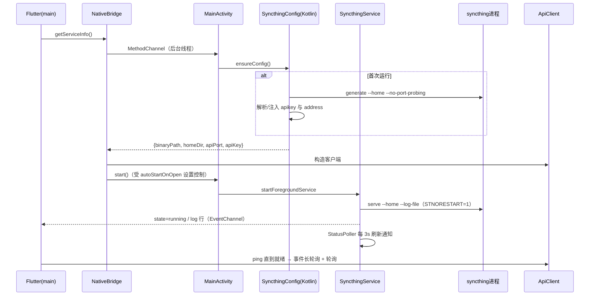
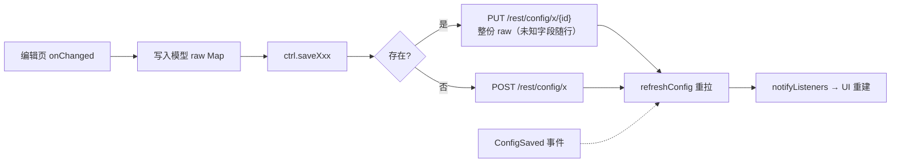

# 详细设计文档（面向开发者 / AI Agent）

> 主文档见 [README.md](../README.md)。本文档逐文件、逐函数说明实现；
> 升级 Syncthing 的检查清单见 [UPDATE_GUIDE.md](UPDATE_GUIDE.md)；
> 工具链与陷阱见 [AI_AGENT.md](AI_AGENT.md)。

## 启动时序

## Kotlin 层（android/app/src/main/kotlin/ai/pikaqiang/syncthing/）

| 文件 | 成员 | 作用 |
|---|---|---|
| `MainActivity.kt` | `onCreate` | API 33+ 请求通知权限 |
| | `onActivityResult` | 选目录（SAF→真实路径）/ 所有文件权限回跳 |
| | `configureFlutterEngine` | 注册 MethodChannel `app.syncthing/native` 与 EventChannel `app.syncthing/events` |
| | `threadToResult` | 后台线程执行防卡 UI |
| | `treeUriToPath` | tree URI → 真实路径（仅 `primary:` 卷，其余 null 由 UI 引导手输） |
| `SyncthingService.kt` | `onStartCommand` | ACTION_START/STOP 分发，START_STICKY |
| | `startSyncthing` | `ProcessBuilder(binary, "serve", "--home", …, "--log-file", …)`，env STNORESTART/STNOUPGRADE/HOME；stdout 逐行→Bus；waitFor 线程负责状态迁移与 stopSelf |
| | `startStatusPoller` | 每 3s：connections（速率差分）+ 各文件夹 db/status → 刷新通知；文件夹列表失败保留 null 重试 |
| | `buildNotification` | 折叠=速率·摘要；展开=InboxStyle 逐文件夹行；同步中带 setProgress |
| | `apiGet/apiGetArray` | HttpURLConnection + X-API-Key（依赖 network_security_config 放行 loopback 明文） |
| | `fmtRate/fmtBytes` | 速率/字节格式化 |
| | `stopSyncthing` | destroy()=SIGTERM，10s 后 destroyForcibly 兜底 |
| `SyncthingConfig.kt` | `ensureConfig` | 首次 `generate`，正则解析 `<apikey>/<address>`（缺失则注入随机 key / 127.0.0.1:8384） |
| | `homeDir/binaryPath` | filesDir/syncthing-home；nativeLibraryDir/libsyncthing.so |
| `SyncthingBus.kt` | `postState/postLog/addListener` | 进程内事件总线（主线程分发，订阅即回放当前状态） |
| `BootReceiver.kt` | `onReceive` | BOOT_COMPLETED/MY_PACKAGE_REPLACED 时按 `flutter.startOnBoot` 自启 |

**MethodChannel 方法表**：`getServiceInfo / start / stop / state / lastError / pickDirectory / requestNotificationPermission / isAllFilesAccessGranted / requestAllFilesAccess / isIgnoringBatteryOptimizations / requestIgnoreBatteryOptimizations / openWebUi`

## Dart 核心层（lib/）

| 文件 | 成员 | 作用 |
|---|---|---|
| `main.dart` | `main()` | 装配 Provider；首帧后 `bootstrap()` |
| `app.dart` | `SyncthingApp/_theme` | DynamicColorBuilder 动态取色（回退种子 0xFF0891B1）；ThemeMode 由 prefs 驱动 |
| `core/app_prefs.dart` | `themeMode` | system/light/dark，默认跟随系统 |
| | `autoStartOnOpen` | 打开 App 自动启动（默认开），bootstrap 依据 |
| | `startOnBoot` | 开机自启（BootReceiver 读） |
| `core/format.dart` | `formatBytes/formatRate/formatDurationSec/formatTime/formatPercent/formatDeviceId` | 展示格式化；设备 ID 已分组则原样返回（v2 返回带横线） |
| `core/native_bridge.dart` | `init/states/logs` | EventChannel 分流 state/log 广播流 |
| | `getServiceInfo` | 首次触发 Kotlin 配置引导，缓存 ServiceInfo |
| | `start/stop/…` | MethodChannel 直通 |
| `syncthing/api_client.dart` | `get/getRaw` | JSON GET / 长轮询原始串（90s） |
| | `post/put/patch/delete` | 统一 `_send`（query+JSON body） |
| | `ping/ApiException` | 探活 / 统一错误 |
| `syncthing/models.dart` | 配置类 | **raw 为唯一事实源**：`Config/FolderConfig/DeviceConfig/GuiConfig/OptionsConfig/VersioningConfig/FolderDeviceRef`。类型化 getter/setter 读写 raw，未知字段读改写全程无损（升级友好核心）。`create(id)` 为兜底模板；`params` 活引用（显式循环转换，dynamic `.map()` 会丢泛型） |
| | 状态类 | `SystemStatus/Connections(+差分 inRate/outRate)/DeviceConnection/FolderStatus(含 completion 计算)/Completion/DeviceStats/PendingDevice/PendingFolder/SyncthingEvent/BrowseEntry(FILE_INFO_TYPE_* 归一化)/FileVersion/SystemVersion/SystemPaths/LogEntry…` 均容错解析不抛异常 |
| `syncthing/controller.dart` | `bootstrap` | getServiceInfo→ApiClient→按设置 start→启动轮询 |
| | `stop/restart` | REST 优雅关闭→等 10s→SIGTERM 兜底 |
| | `_fastPoll`（5s） | status+connections（`_computeRates` 差分速率，v2 无 *BytesPerSec）+ 各文件夹 db/status |
| | `_slowPoll`（30s） | config/version/completions/pending/stats/errors |
| | `_eventLoop` | `/rest/events` 长轮询；初始追赶带就绪检查与捕获；服务重启重置 `_lastEventId` |
| | `_handleEvent` | 按类型定向刷新（ItemFinished→最近更改，ConfigSaved→重拉配置，FolderSummary→单文件夹…） |
| | 配置写操作 | `saveFolder/deleteFolder/saveDevice/deleteDevice/patchOptions/putOptions/putGui/putRawConfig/folderTemplate/deviceTemplate`（defaults 模板，新建零适配） |
| | 动作 | `rescanFolder/rescanAll/override/revert/pauseFolder/pauseDevice/clearErrors/accept·dismissPendingDevice·Folder/setUsageReport` |
| | 文件夹内 | `browse(levels=1)/getIgnores/setIgnores/matchIgnores/folderVersions/restoreVersions/validateDeviceId/logLevels/browseFsPath` |
| | `ProcessLogLine.parse` | 解析 v2 日志 `时间 INF|WRN|ERR|DBG 消息 (log.pkg=x)` |

## UI 层（lib/ui/）

| 文件 | 组件 | 作用 |
|---|---|---|
| `shell.dart` | `HomeShell` | NavigationBar×5（IndexedStack 保状态）；GestureDetector 空白收起键盘 |
| `widgets/common.dart` | `ServiceStatusCard` | 状态/资源/启停 |
| | `showDeviceIdDialog` | 二维码+分组 ID+复制 |
| | `confirmDialog/showSnack` | 通用确认 / 提示 |
| | `FolderStateView.of` | 文件夹状态→中文+颜色（含 receiveOnly 本地改动、扫描百分比） |
| `overview/overview_page.dart` | `_SyncBanner` | 同步中聚合卡：速率+逐文件夹进度条 |
| | `_ThisDeviceCard/_PendingDevices·FoldersCard/_FolderTile/_DeviceTile/_RecentChangesCard/_StatsCard` | 总览各区块 |
| `folders/folders_page.dart` | `FoldersPage` | 列表+类型图标+待定提示 |
| `folders/folder_detail_page.dart` | `FolderDetailPage` 等 | 进度/统计四列表/各设备完成度/失败项/入口；菜单=重扫/覆盖/回退（条件显隐）/暂停/编辑/删除 |
| `folders/folder_edit_page.dart` | `FolderEditPage` | 新建用 defaults 模板；标签自动生成 ID；路径 SAF 选择器（controller 回填）；6 种版本控制参数表单 |
| `folders/ignore_patterns_page.dart` | `IgnorePatternsPage` | 编辑+`POST ?check` 规则测试 |
| `folders/folder_browse_page.dart` | `FolderBrowsePage` | 逐层浏览，目录优先 |
| `folders/folder_versions_page.dart` | `FolderVersionsPage` | 版本列表→单版本恢复 |
| `devices/devices_page.dart` | `DevicesPage` | 本机/远程/待定 |
| `devices/device_edit_page.dart` | `DeviceEditPage` | ID 扫码/粘贴/服务端校验；压缩/介绍人/自动接受/限速；共享文件夹写回 |
| `devices/device_scanner_page.dart` | `DeviceIdScannerPage` | mobile_scanner（仅 QR）+取景框+权限错误提示 |
| `logs/logs_page.dart` | `LogsPage/_LogCard/_ErrorsTab` | MD3 卡片流：等级配色（ERR 容器/WRN 琥珀/INF 表面/DBG 描边）、时间·级别·包名脚注、行内复制；SegmentedButton 筛选+搜索；错误 Tab |
| `settings/settings_page.dart` | `SettingsPage/_GatedOnService/_RateTile/_EditTextTile/RawConfigPage` | 外观/服务（自启×2/权限/WebUI）/常规/连接/GUI/动作/高级 JSON 直编/关于；**服务未运行时 GatedOnService 横幅+禁用** |

## 数据流：配置写路径

## 构建配置

| 文件 | 要点 |
|---|---|
| `android/app/build.gradle.kts` | abiFilters 默认 `arm64-v8a`（`-PtargetAbi=` 覆盖，模拟器调试用 `arm64-v8a,x86_64`）；**`useLegacyPackaging=true`**（.so 必须解压才可 exec）；AGP 9.0.1 / Kotlin 2.3.20 |
| `android/settings.gradle.kts` | pluginManagement 走 dl.google.com 直链（maven.google.com 被墙时） |
| `res/xml/network_security_config.xml` | 仅放行 loopback 明文 HTTP（Kotlin 轮询必需；Dart 侧不受限曾致通知静默失败） |
| `AndroidManifest.xml` | INTERNET/CAMERA/FGS(dataSync)/POST_NOTIFICATIONS/BOOT/MANAGE_EXTERNAL_STORAGE/电池优化 |
| `third_party/syncthing/BINARY.txt` | 内嵌二进制溯源（Termux 构建/校验和/验证记录） |
| `tools/gen_icon.py` | PIL 生成 MD3 自适应图标（前景须在 66/108 安全区，脚本自检） |
